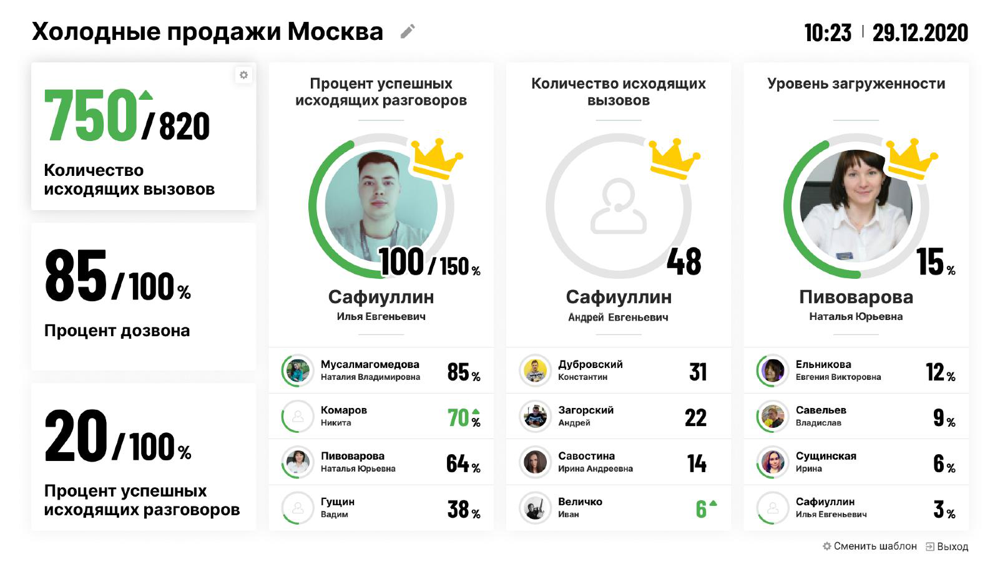

# 4. Главное окно модуля

> Трассировка: PDF §4 · сквозные стр. 23-24 · источники: ч.1 `kb/sources/wallboard/Programma-dlya-EVM-Wallboard-Mango-Office_v7.22.25.pdf` с.23-24.

> **Описание иллюстрации WB-§4-1** (к §4 «Главное окно модуля», стр. 23; 1602×901 px). Снимок экрана / схема.
> Относится к тексту руководства: «…за текущий месяц, ответственными исполнителями которых (на момент выгрузки данных) являются сотрудники выбранной».
> Текст на изображении (OCR, требует сверки): Холодные продажи Москва х; 10:23 | 29.12.2020; Процент успешных; Количество исходящих; Уровень загруженности; исходящих разговоров; вызовов; 7507820; Количество; My; исходящих вызовов; 48; 85 лос,; Сафиуллин; Пивоварова; Илья Евгеньевич; Наталья Юрьевна; Андрей Евгеньевич; Процент дозвона; Мусалмагомедова; Наталия Владимировна; 85.; Константин; Дубровский; Ельникова; Евгения Викторовна; 12.; Никита; Комаров; 70%; Андрей; Загорский; 22; Владислав.; Савельев; 9x; 20 лс,; Савостина; Сущинская; 64,; Ирина Андреевна; Ирина; Гущин; Иван; Величко; Вадим; 38x; 3x; $} Сменить шаблон; 3] Выход

На главном окне отображаются:

> **Описание иллюстрации WB-§4-2** (к §4 «Главное окно модуля», стр. 23; 15×15 px). Пиктограмма (значок элемента интерфейса).
> Относится к тексту руководства: «…На главном окне отображаются:».
> Текста на изображении нет; назначение элемента — см. текст, к которому он относится.

1) Наименование монитора – его можно отредактировать кликом по пиктограмме «карандаш»; 2) Текущие дата и время; 3) Три блока общих групповых показателей; 4) Три блока персональных показателей - рейтингов;

> **Описание иллюстрации WB-§4-3** (к §4 «Главное окно модуля», стр. 24; 19×18 px). Пиктограмма (значок элемента интерфейса).
> Относится к тексту руководства: «…тировать кликом по пиктограмме «карандаш»; 2) Текущие дата и время; 3) Три блока общих групповых показателей; 4) Три блока персональных показателей - рейтингов;».
> Текста на изображении нет; назначение элемента — см. текст, к которому он относится.

5) Пиктограмма смены шаблона – клик по пиктограмме открывает окно выбора шаблона;

> **Описание иллюстрации WB-§4-4** (к §4 «Главное окно модуля», стр. 24; 12×11 px). Пиктограмма (значок элемента интерфейса).
> Относится к тексту руководства: «…5) Пиктограмма смены шаблона – клик по пиктограмме открывает окно выбора шаблона;».
> Текста на изображении нет; назначение элемента — см. текст, к которому он относится.

6) Пиктограмма выхода из учетной записи.
