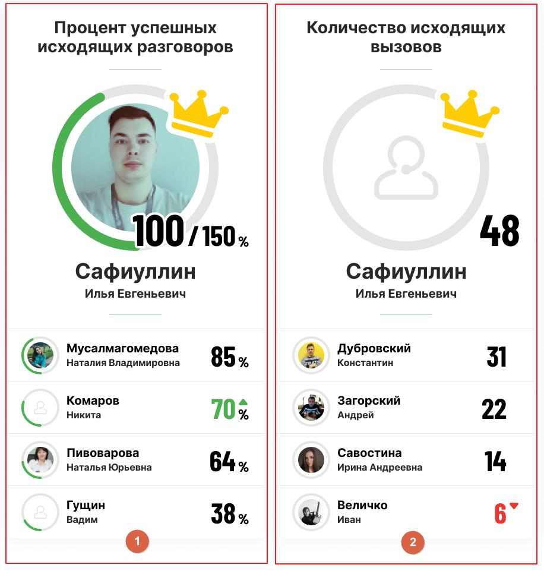

### 4.1.1. Рейтинг по сотрудникам

> Трассировка: PDF §4.1.1 · сквозные стр. 24-27 · источники: ч.1 `kb/sources/wallboard/Programma-dlya-EVM-Wallboard-Mango-Office_v7.22.25.pdf` с.24-27.

Сотрудники располагаются в рейтинге в порядке убывания значения показателя. Лидер рейтинга выделяется крупным аватаром с серым, зелёным или красным прогресс-баром выполнения.

> **Описание иллюстрации WB-§4.1.1-1** (к §4.1.1 «Рейтинг по сотрудникам», стр. 25; 916×966 px). Снимок экрана / схема.
> Относится к тексту руководства: «…полагаются в рейтинге в порядке убывания значения показателя. Лидер рейтинга выделяется крупным аватаром с серым, зелёным или красным прогресс-баром выполнения.».
> Подпись в руководстве: «Рис. 1 – плановое значение показателя задано. Рис. 2 - плановое значение показателя не задано.».
> Текст на изображении (OCR, требует сверки): Процент успешных; Количество исходящих; исходящих разговоров; вызовов; id; ty; fr; mat if; 100 /150..; 48; Сафиуллин; Илья Евгеньевич; Мусалмагомедова; Дубровский; Наталия Владимировна; 85,; Константин; Комаров; Загорский; Никита; 70%; Андрей; 22; Пивоварова; Савостина; Наталья Юрьевна; 64.; Ирина Андреевна; 14; Гущин; Величко; вадим; 38»; Иван

Рис. 1 – плановое значение показателя задано. Рис. 2 - плановое значение показателя не задано.

Если плановое значение показателя задано: плановое значение показателя отображается у лидера рейтинга (на рис. 1 плановое значение равно 150%). Выполнение плана визуально отображается на аватаре сотрудника в виде рамки – прогресс-бара – зелёного (положительный показатель) или красного (отрицательный показатель) цвета.

этом случае прогресс-бар заполняется на 100%, рядом с аватаром лидера рейтинга отображается выбранная в настройках «положительная» или «отрицательная» иконка.

Если плановое значение показателя не задано: цветная рамка лидера и сотрудников не имеет функции прогресс-бара, а «положительная» или «отрицательная» иконка у лидера отображается постоянно.

Рост и снижение показателей отмечаются треугольниками зеленого и красного цветов соответственно. Если после формирования виджета сотрудник был добавлен в группу или удален из группы, то:

• в случае настройки виджета «Все сотрудники», результат добавленного сотрудника появляется в рейтинге (а результат удаленного - удаляется из рейтинга) без необходимости перенастройки виджета;

• в случае если в настройках виджета выбран удаленный сотрудник, его результат удаляется из рейтинга без необходимости перенастройки виджета;

• в случае если в настройках виджета выбраны не все сотрудники, результаты добавленного сотрудника не появляются в рейтинге, при этом он доступен в настройках виджета.
