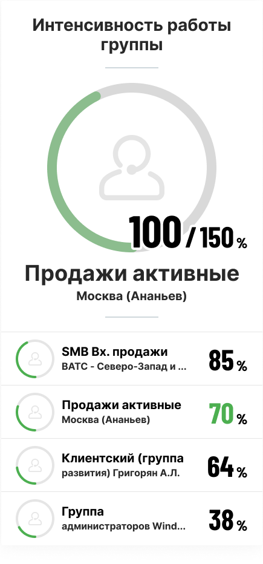

### 4.1.2. Рейтинг по группам

> Трассировка: PDF §4.1.2 · сквозные стр. 27-28 · источники: ч.1 `kb/sources/wallboard/Programma-dlya-EVM-Wallboard-Mango-Office_v7.22.25.pdf` с.27-28.

Группы располагаются в рейтинге в порядке убывания значения показателя.

> **Описание иллюстрации WB-§4.1.2-1** (к §4.1.2 «Рейтинг по группам», стр. 27; 435×932 px). Снимок экрана / схема.
> Относится к тексту руководства: «…Группы располагаются в рейтинге в порядке убывания значения показателя.».
> Текст на изображении (OCR, требует сверки): Интенсивность работы; группы; 100 /тъо.,; Продажи активные; Москва (Ананьев); SMB Вх. продажи; ВАТС - Северо-Запад и ..; 85x.; 70%; Клиентский (группа; развития) Григорян А.Л.; 64,; Группа; администраторов Wind..; 58x

Если плановое значение показателя задано: плановое значение показателя отображается у лидера группового рейтинга (на рисунке выше плановое значение равно 150%). Выполнение плана

визуально отображается на аватаре группы в виде рамки – прогресс-бара – зелёного (положительный показатель) или красного (отрицательный показатель) цвета.

План считается выполненным, когда значение показателя равно или больше планового значения. В этом случае прогресс-бар заполняется на 100%, рядом с аватаром лидера группового рейтинга отображается выбранная в настройках «положительная» или «отрицательная» иконка.

Если плановое значение показателя не задано: цветная рамка группы-лидера и других групп не имеет функции прогресс-бара, а «положительная» или «отрицательная» иконка у лидера отображается постоянно.
