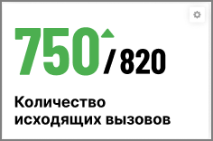

## 4.2. Общие групповые показатели

> Трассировка: PDF §4.2 · сквозные стр. 28 · источники: ч.1 `kb/sources/wallboard/Programma-dlya-EVM-Wallboard-Mango-Office_v7.22.25.pdf` с.28.

> **Описание иллюстрации WB-§4.2-1** (к §4.2 «Общие групповые показатели», стр. 28; 236×156 px). Снимок экрана / схема.
> Относится к тексту руководства: «…задано: цветная рамка группы-лидера и других групп не имеет функции прогресс-бара, а «положительная» или «отрицательная» иконка у лидера отображается постоянно.».
> Текст на изображении (OCR, требует сверки): 7507820; Количество; исходящих вызовов

Блок содержит:

• Наименование показателя; • Данные о текущем и плановом (если задано) значении показателя. Для положительных показателей текущие данные выводятся зеленым цветом, для отрицательных – красным; • Пиктограмма «треугольник» динамики показателя (зелёный – рост, красный - снижение).

| Если после формирования виджета сотрудник был добавлен в группу или удален из группы, при |  |  |  |
| --- | --- | --- | --- |
| ближайшем обновлении данных значение показателя учитывает изменения в составе группы без |  |  |  |
| необходимости перенастройки виджета. |  |  |  |

Если после формирования виджета сотрудник был добавлен в группу или удален из группы, при ближайшем обновлении данных значение показателя учитывает изменения в составе группы без необходимости перенастройки виджета.
